# Práctica 1 · Modelos de servicio y despliegue: consolas, calculadoras de costos y alertas de presupuesto

**Instituto Politécnico Nacional · ESCOM** · Sistemas Distribuidos · Grupo 7CV1
**Profesor:** Rodrigo Ojeda Santillán
**Equipo:** 1
**Repositorio:** [Jpani1251/Practica1_S.D](https://github.com/Jpani1251/Practica1_S.D)

| Integrante | Usuario GitHub | Proveedores |
|---|---|---|
| Jorge Alberto Paniagua Escamilla | [@Jpani1251](https://github.com/Jpani1251) | AWS, Azure |
| Saúl Andrés Bernal Jardón | [@sAs-Sus](https://github.com/sAs-Sus) | AWS, Azure |
| Carlos Antonio Hernández Villeda | [@CarlosAHV](https://github.com/CarlosAHV) | Azure, Google Cloud |

---

## 1. Cuentas, unidad de facturación y región México (A1)

### Tabla 1. Cuentas del equipo

| Integrante | Proveedor | Identificador de cuenta | Unidad de facturación | Región México | Créditos y vencimiento | Correo de alertas |
|---|---|---|---|---|---|---|
| Jorge Alberto Paniagua Escamilla | AWS | 5133-2923-2970 | Cuenta de AWS | Sí · `mx-central-1` (Querétaro) | 100 USD · vence 06/10/2027 · usado 0.00 | jpaniaguae1800@alumno.ipn.mx |
| Jorge Alberto Paniagua Escamilla | Azure | `71ce701b-47c1-4c8f-a31e-a31e53b7481f` | Suscripción Azure for Students | Sí · Mexico Central (Querétaro) | 100 USD · vence 06/10/2027 · usado 0.00 | jpaniaguae1800@alumno.ipn.mx |
| Saúl Andrés Bernal Jardón | AWS | 3187-6773-0167 | Cuenta de AWS | Sí · `mx-central-1` (Querétaro), activada el 14/10/2026 | 100 USD · vence 14/10/2027 · usado 0.00 | bernals798@gmail.com |
| Saúl Andrés Bernal Jardón | Azure | `7b77a8cb-be26-4e9b-9e58-92f2c335d428` | Suscripción de la cuenta gratuita de Azure | Sí · Mexico Central | 200 USD · vence 14/11/2026 · usado 0.00 | bernals798@gmail.com |
| Carlos Antonio Hernández Villeda | Azure | Azure subscription 1 | Suscripción | Sí · Mexico Central | 200 USD · vence en 12 meses | karlosantonio0117@gmail.com |
| Carlos Antonio Hernández Villeda | Google Cloud | `project-89c5f5f4-4595-4f32-a0c` | Cuenta de facturación y proyecto | Sí · `northamerica-south1` (Querétaro) | 300 USD (MXN 5,344) · vence en 90 días | karlosantonio0117@gmail.com |

### Evidencias A1 — Jorge Paniagua

| AWS | |
|---|---|
| Inicio de la consola con el ID de la cuenta |  |
| Lista de regiones con México |  |
| Región cambiada a México |  |
| Facturación del mes en 0.00 |  |
| Créditos de 100 USD |  |

| Azure | |
|---|---|
| Suscripción Azure for Students |  |
| Región Mexico Central |  |
| Créditos de 100 USD y gasto del mes en 0.00 |  |

### Evidencias A1 — Saúl Bernal

| AWS | |
|---|---|
| Inicio de la consola con el ID de la cuenta | 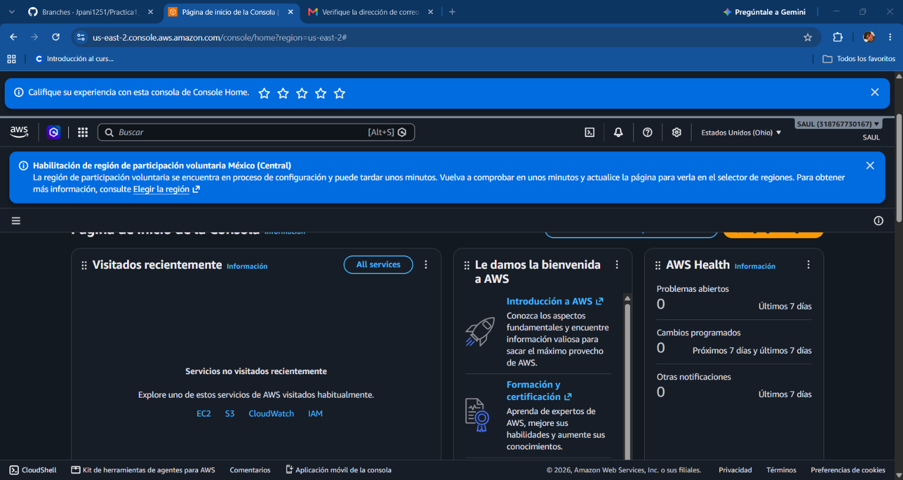 |
| Lista de regiones | 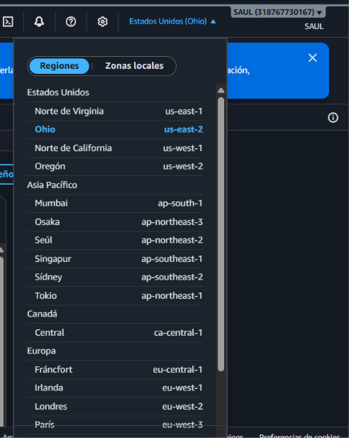 |
| Región cambiada a México | 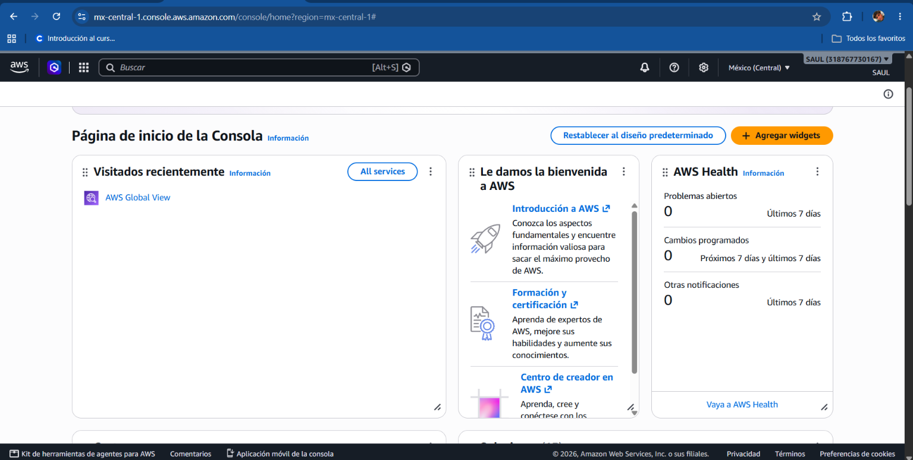 |
| Facturación del mes en 0.00 | 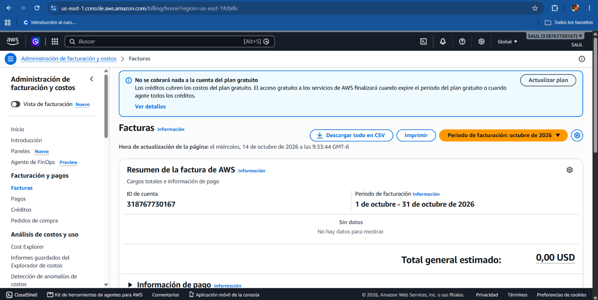 |
| Créditos de 100 USD | 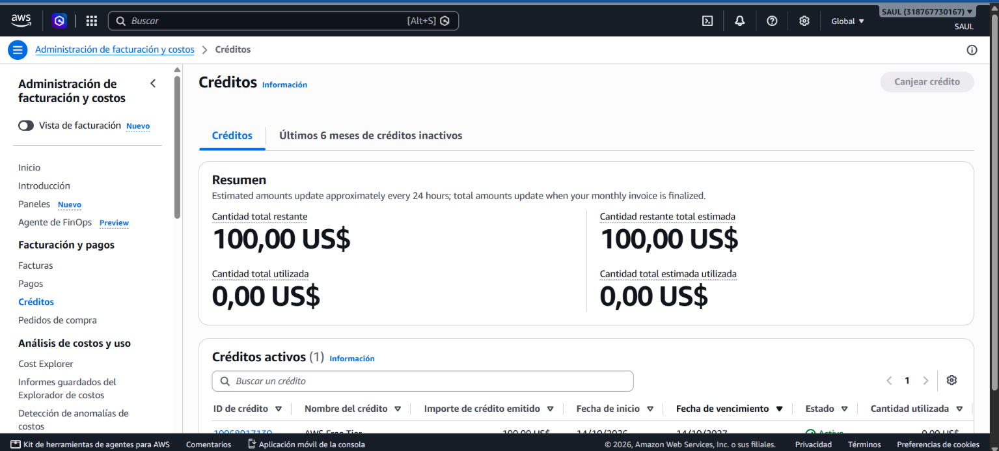 |

| Azure | |
|---|---|
| Suscripción con su ID y costo en 0.00 | 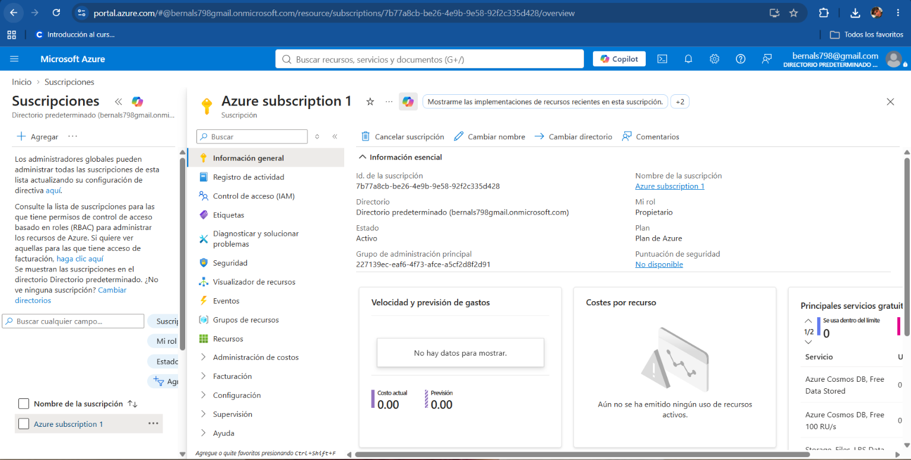 |
| Región Mexico Central | 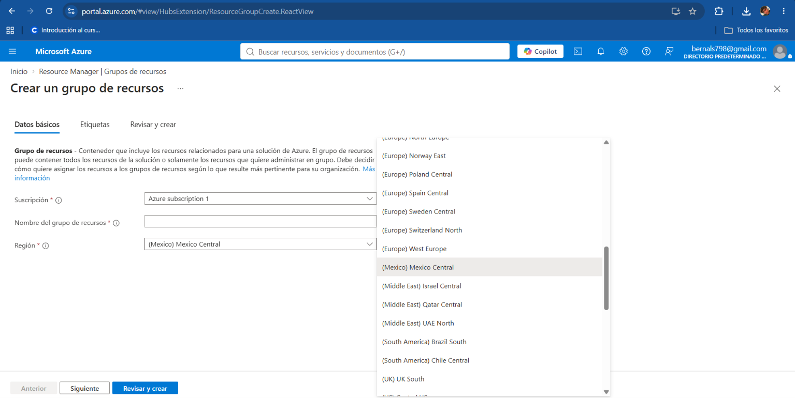 |
| Facturación en 0.00 y aviso de que el crédito vence en 30 días | 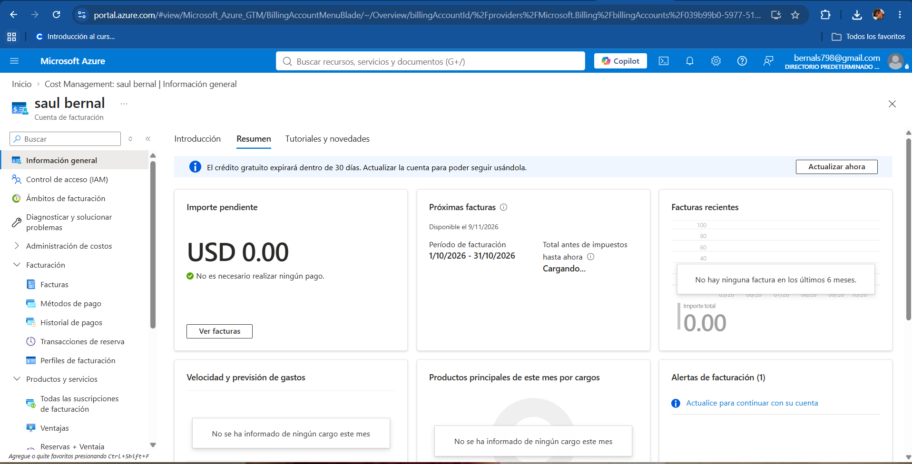 |

### Evidencias A1 — Carlos Hernández

| Azure | |
|---|---|
| Suscripción |  |
| Región Mexico Central |  |
| Facturación del mes |  |

| Google Cloud | |
|---|---|
| Inicio con el ID del proyecto |  |
| Región `northamerica-south1` (México) |  |
| Facturación del mes |  |

---

## 2. Alertas de presupuesto (A2)

| Integrante | Proveedor | Presupuesto | Monto | Umbrales | Destinatario | Estado |
|---|---|---|---|---|---|---|
| Jorge Paniagua | AWS | `P1-Jorge_Paniagua-aws-cero` | Gasto cero | Avisa si se gasta cualquier cantidad | jpaniaguae1800@alumno.ipn.mx | En buen estado · 0.00 |
| Jorge Paniagua | AWS | `P1-Jorge_Paniagua-aws` | 5 USD al mes | Real 50 %, 80 % y 100 % · Previsto 100 % | jpaniaguae1800@alumno.ipn.mx | Sin alertas · 0.00 |
| Jorge Paniagua | Azure | `P1-Jorge_Paniagua-azure` | 5 USD al mes | Real 50 %, 80 % y 100 % · Previsto 100 % | jpaniaguae1800@alumno.ipn.mx | Sin alertas · 0.00 |
| Saúl Bernal | AWS | `P1-Saul_Bernal-aws-cero` | Gasto cero | Avisa si se gasta cualquier cantidad | bernals798@gmail.com | En buen estado · 0.00 |
| Saúl Bernal | AWS | `P1-Saul_Bernal-aws` | 5 USD al mes | Real 50 %, 80 % y 100 % · Previsto 100 % | bernals798@gmail.com | En buen estado · 0.00 |
| Saúl Bernal | Azure | `P1-Saul_Bernal-azure` | 5 USD al mes | Real 50 %, 80 % y 100 % · Previsto 100 % | bernals798@gmail.com | Sin alertas · 0.00 |
| Carlos Hernández | Azure | `P1-CarlosAHV-azure` | 5 USD al mes | Real 50 %, 80 % y 100 % · Previsto 100 % | karlosantonio0117@gmail.com | Activo |
| Carlos Hernández | Google Cloud | `P1_CarlosAHV_gcp` | 5 USD al mes | Real 50 %, 90 % y 100 % · Previsto 100 % | karlosantonio0117@gmail.com | Activo |

**Evidencias A2**

| Captura | |
|---|---|
| Jorge · AWS · presupuesto de gasto cero |  |
| Jorge · AWS · presupuesto de 5 USD con sus 4 alertas |  |
| Jorge · Azure · presupuesto con umbrales y correo |  |
| Jorge · Azure · sin alertas disparadas |  |
| Saúl · AWS · lista de presupuestos en 0.00 | 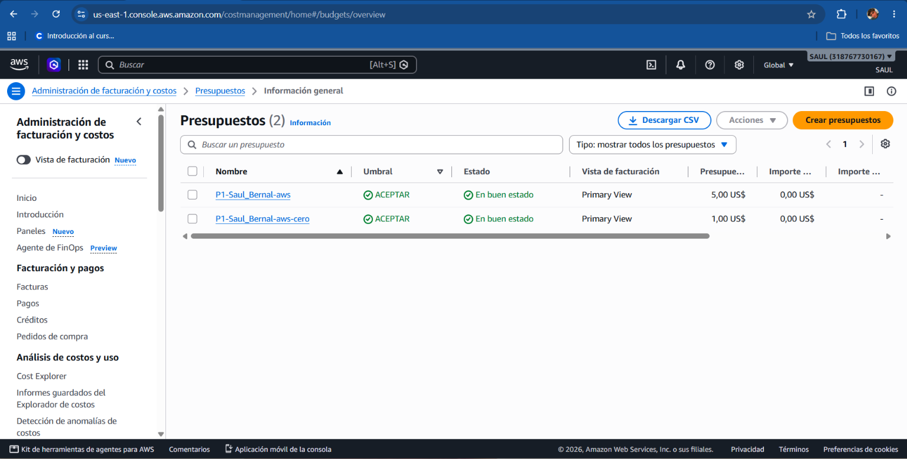 |
| Saúl · AWS · correo de alertas verificado | 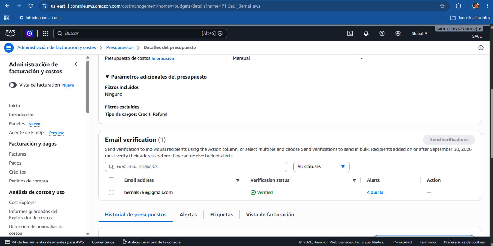 |
| Saúl · AWS · las 4 alertas | 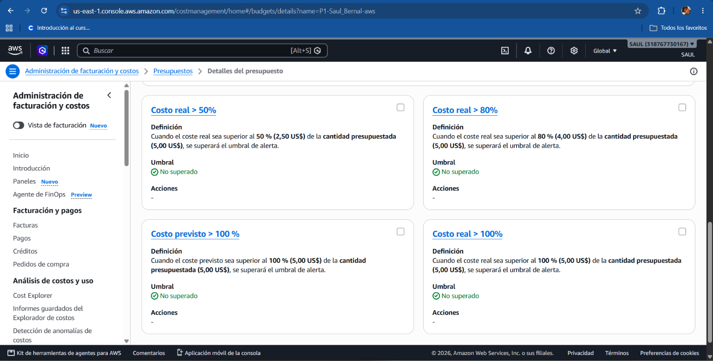 |
| Saúl · AWS · presupuesto de gasto cero | 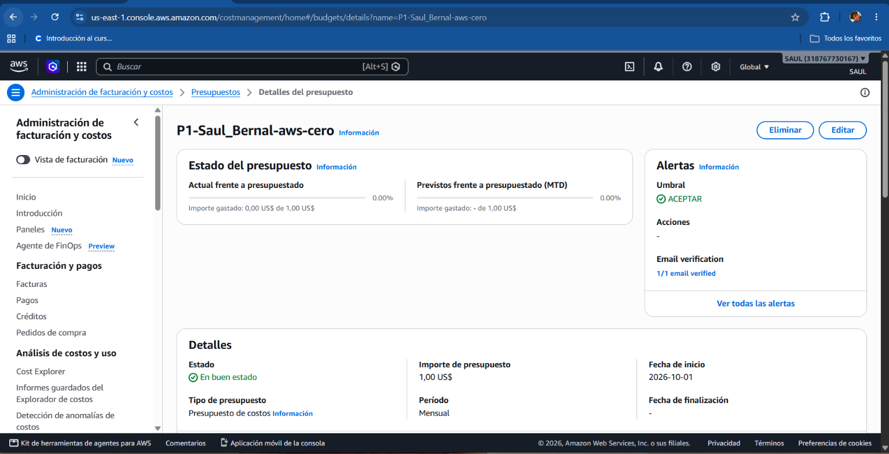 |
| Saúl · AWS · alertas de capa gratuita activadas | 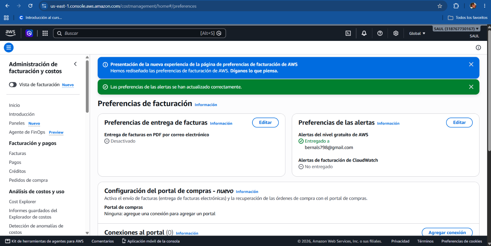 |
| Saúl · Azure · presupuesto con umbrales y correo | 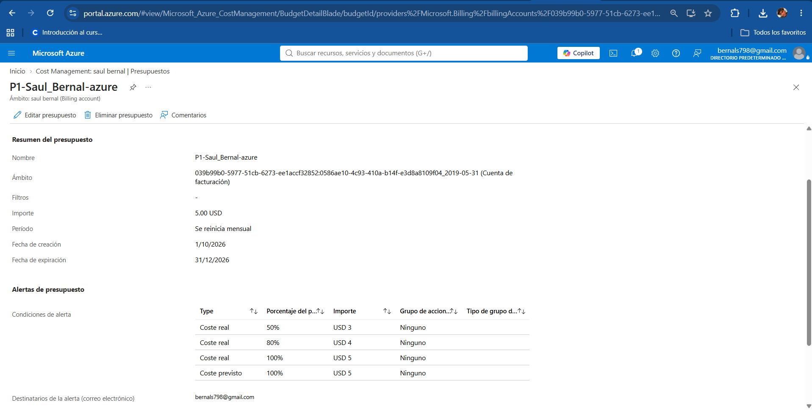 |
| Saúl · Azure · sin alertas disparadas | 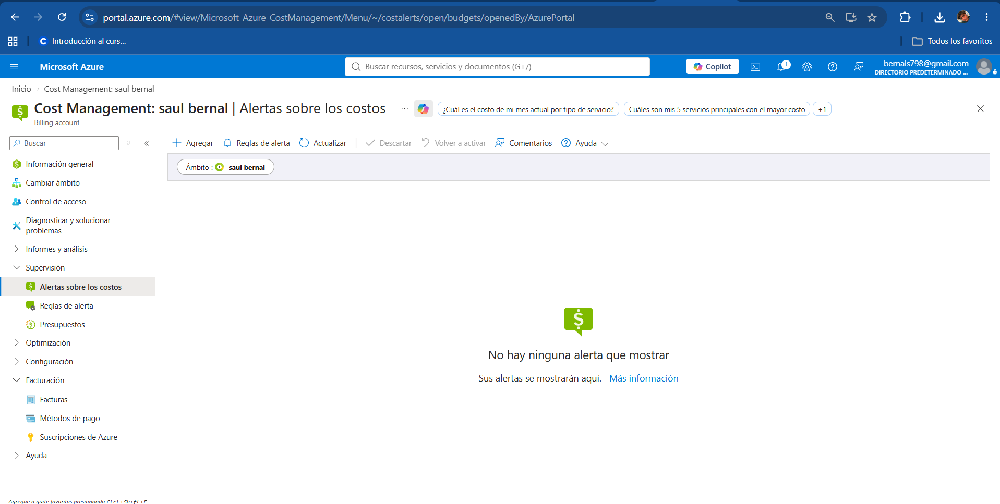 |
| Saúl · AWS · día siguiente (15/10/2026): presupuestos en 0.00 | 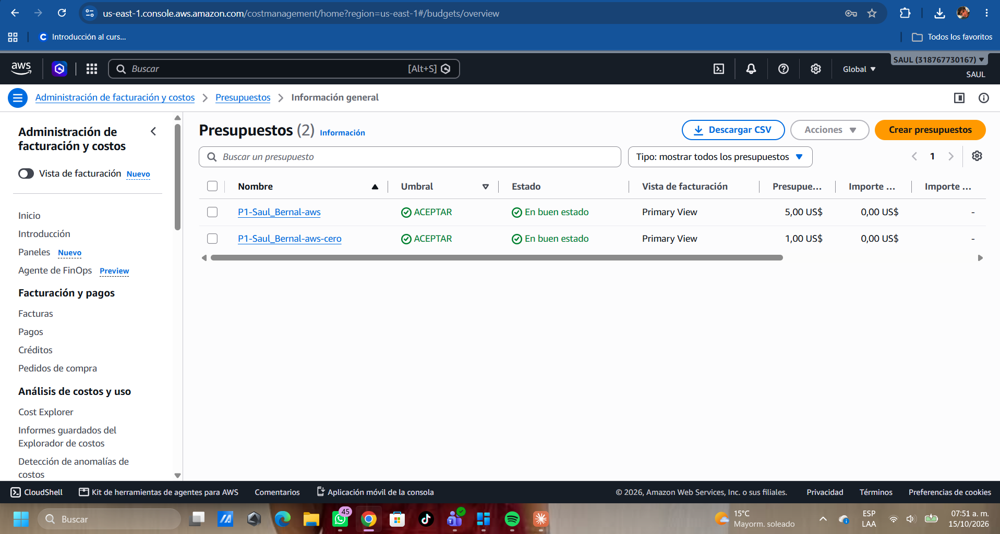 |
| Carlos · Azure · presupuesto de 5 USD |  |
| Carlos · Google Cloud · presupuesto con alertas de 50 %, 90 % y 100 % |  |
| Carlos · Azure · presupuesto activo |  |

---

## 3. Estimación de costos de la arquitectura de referencia (A3)

**Arquitectura:** una máquina virtual Linux de 2 vCPU y 4 GB encendida todo el mes con 30 GB de disco, una base de datos pequeña con 20 GB, 50 GB de almacenamiento de objetos con 100 000 solicitudes, un balanceador de carga y 100 GB de salida a internet al mes.

| Recurso | AWS | Azure |
|---|---|---|
| Máquina virtual | EC2 `t3.medium` + disco de 30 GB | VM `B2s` + disco `E4` de 32 GB |
| Base de datos | RDS MySQL `db.t4g.small` + 20 GB | MySQL Flexible Server `B1ms` + 20 GB |
| Objetos | S3 Standard, 50 GB | Blob Storage, 50 GB |
| Balanceador | Application Load Balancer | Application Gateway Basic |
| Salida a internet | 100 GB | 100 GB |

Comparamos México contra la región más barata de Estados Unidos: **us-east-1** en AWS y **East US** en Azure.

### Tabla 2a. AWS

| Recurso | Unidad de cobro | Cantidad | México (USD/mes) | EE. UU. (USD/mes) | ¿Capa gratuita? |
|---|---|---|---|---|---|
| Máquina virtual + disco | Hora de instancia + GB al mes | 730 h + 30 GB | 34.42 | 32.77 | Se paga con los créditos |
| Base de datos | Hora de instancia + GB al mes | 730 h + 20 GB | 27.24 | 25.66 | Se paga con los créditos |
| Objetos (S3) | GB al mes + solicitudes | 50 GB + 100 000 solicitudes | 1.49 | 1.42 | Se paga con los créditos |
| Balanceador | Hora + unidad de capacidad | 730 h | 23.38 | 22.27 | Se paga con los créditos |
| Salida a internet | GB de salida | 100 GB | 9.00 | 9.00 | Sí, los primeros 100 GB al mes son gratis |
| **Total mensual** | | | **95.53** | **91.12** | |
| **Total anual** | | | **1 146.36** | **1 093.44** | |
| **Diferencia** | | | **+4.41 USD/mes (+4.8 %)** | | |

### Tabla 2b. Azure

| Recurso | Unidad de cobro | Cantidad | México (USD/mes) | EE. UU. (USD/mes) | ¿Capa gratuita? |
|---|---|---|---|---|---|
| Máquina virtual + disco | Hora de VM + disco al mes | 730 h + 1 disco | 36.07 | 32.77 | No, se paga con los créditos |
| Base de datos | Hora de vCore + GB al mes | 730 h + 20 GB | 16.18 | 14.71 | Sí, gratis por 12 meses |
| Objetos (Blob) | GB al mes + operaciones | 50 GB + 100 000 operaciones | 1.44 | 1.31 | Solo los primeros 5 GB |
| Balanceador | Hora + unidad de capacidad | 730 h | 23.38 | 22.27 | No |
| Salida a internet | GB de salida | 100 GB | 0.00 | 0.00 | Sí, los primeros 100 GB al mes son gratis |
| **Total mensual** | | | **77.07** | **71.05** | |
| **Total anual** | | | **924.84** | **852.64** | |
| **Diferencia** | | | **+6.02 USD/mes (+8.5 %)** | | |

**Exportaciones de las calculadoras** (en `evidencias/P01/costos/`):

| Archivo | Calculadora | Total mensual |
|---|---|---|
| `P01_A3_aws_mx_us_estimacion.csv` | AWS Pricing Calculator (México y EE. UU. en el mismo archivo) | México 95.53 · EE. UU. 91.12 |
| `P01_A3_azure_mx_estimacion.xlsx` | Azure Pricing Calculator, México | 77.07 |
| `P01_A3_azure_us_estimacion.xlsx` | Azure Pricing Calculator, EE. UU. | 71.05 |

### Estimación del proyecto (proveedor candidato: Azure)

| Recurso | Servicio | Unidad de cobro | Precio en México (USD/mes) | ¿Capa gratuita? | Costo con Azure for Students |
|---|---|---|---|---|---|
| Backend / API | App Service `B1` (o `F1` gratis para pruebas) | Hora de plan | 13.65 | `F1` sí; `B1` no | 0 con `F1` · 13.65 con `B1` |
| Base de datos | MySQL Flexible `B1ms` + 20 GB | Hora + GB al mes | 16.18 | Sí, 12 meses | 0 |
| Archivos | Blob Storage, 5 GB | GB al mes | 0.11 | Sí, 5 GB | 0 |
| Tareas en segundo plano | Azure Functions | Ejecuciones | 0.00 | 1 millón de ejecuciones al mes gratis | 0 |
| Salida a internet | Menos de 100 GB | GB | 0.00 | 100 GB gratis | 0 |
| **Total** | | | **29.94** | | **0 a 13.65 USD/mes** |

---

## 4. Modelos de servicio en la consola (B1)

### Modelos de servicio identificados en la consola

| Proveedor | Servicio | Modelo | Administra el proveedor | Administras tú | Unidad de cobro | Capa gratuita | En México |
|---|---|---|---|---|---|---|---|
| AWS | EC2 | IaaS | Hardware y red física | Sistema operativo, aplicación y datos | Hora de instancia + GB de disco | Con créditos | Sí |
| AWS | Elastic Beanstalk | PaaS | Sistema operativo, actualizaciones y escalado | Código | Sin costo propio; se pagan los recursos que crea | Con créditos | No |
| AWS | Lambda | FaaS | Todo, menos el código | Código de la función | Solicitudes + GB-segundo | 1 millón de solicitudes al mes gratis | Sí |
| AWS | EKS | Contenedores | Plano de control de Kubernetes | Contenedores y nodos | 0.10 USD por hora por clúster + nodos | Con créditos | Sí |
| AWS | RDS for MySQL | Base de datos gestionada | Instalación, actualizaciones y respaldos | Esquema y datos | Hora de instancia + GB al mes | Con créditos | Sí |
| AWS | S3 | Almacenamiento de objetos | Durabilidad y replicación | Archivos y permisos | GB al mes + solicitudes | Con créditos | Sí |
| AWS | Bedrock | IA gestionada | Modelo e infraestructura | Prompts y datos | Por millón de tokens | Con créditos | Sí |
| Azure | Virtual Machines | IaaS | Hardware y red física | Sistema operativo, aplicación y datos | Hora de VM + disco al mes | 750 h al mes de `B1s` por 12 meses | Sí |
| Azure | App Service | PaaS | Sistema operativo, actualizaciones y escalado | Código y datos | Hora del plan | Plan `F1` gratis | Sí |
| Azure | Functions | FaaS | Todo, menos el código | Código de la función | Ejecuciones + GB-segundo | 1 millón de ejecuciones al mes gratis | Sí |
| Azure | AKS | Contenedores | Plano de control | Contenedores y nodos | Plano de control gratis o 0.10 USD por hora + nodos | Plano de control gratis | Sí |
| Azure | Database for MySQL | Base de datos gestionada | Instalación, actualizaciones y respaldos | Esquema y datos | Hora + GB al mes | `B1ms` gratis por 12 meses | Sí |
| Azure | Blob Storage | Almacenamiento de objetos | Durabilidad y replicación | Archivos y permisos | GB al mes + operaciones | 5 GB por 12 meses | Sí |
| Azure | Azure OpenAI | IA gestionada | Modelo e infraestructura | Prompts y datos | Por millón de tokens | No | Parcial |
| SaaS | GitHub / Microsoft 365 | SaaS | Todo | Uso y configuración | Usuario por mes | GitHub Free | — |

| # | Servicio | Qué muestra | Captura |
|---|---|---|---|
| 1 | AWS · EC2 | Precio por hora en México | 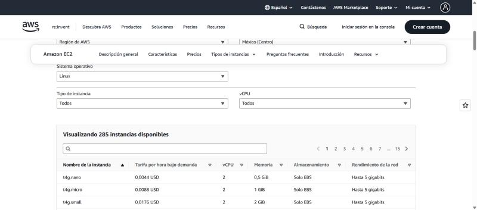 |
| 2 | AWS · Elastic Beanstalk | No tiene costo propio | 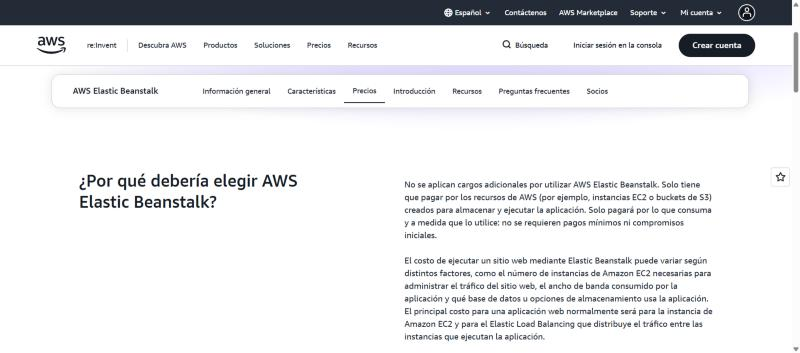 |
| 3 | AWS · Lambda | Precio por GB-segundo y por millón de solicitudes en México | 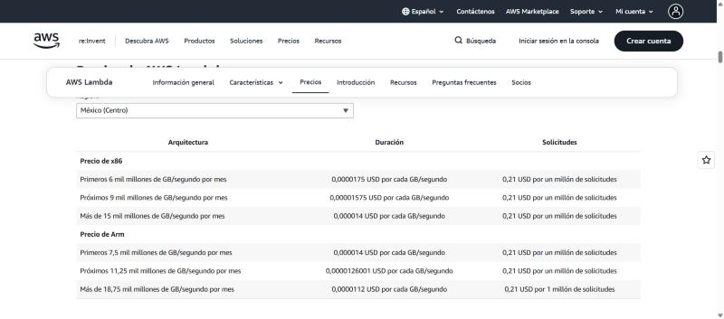 |
| 4 | AWS · EKS | 0.10 USD por clúster por hora | 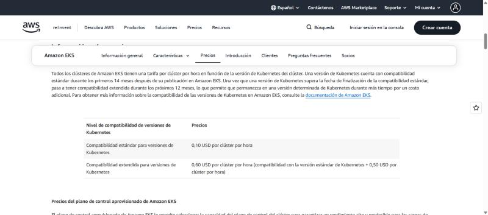 |
| 5 | AWS · RDS for MySQL | Precio por hora en México | 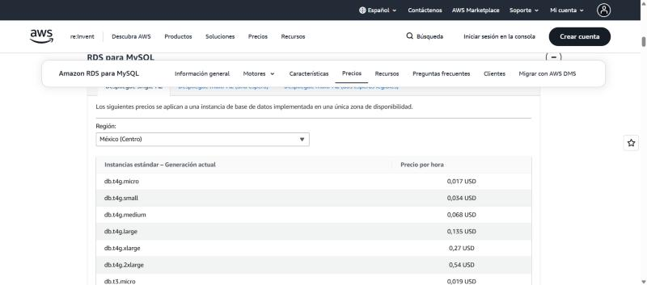 |
| 6 | AWS · S3 | Precio por GB al mes en México | 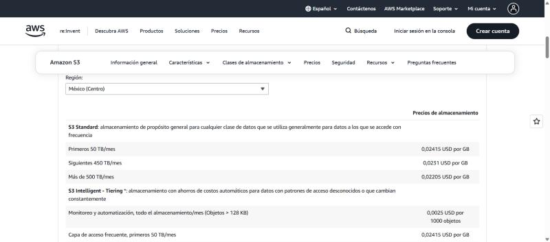 |
| 7 | AWS · Bedrock | Precio por millón de tokens | 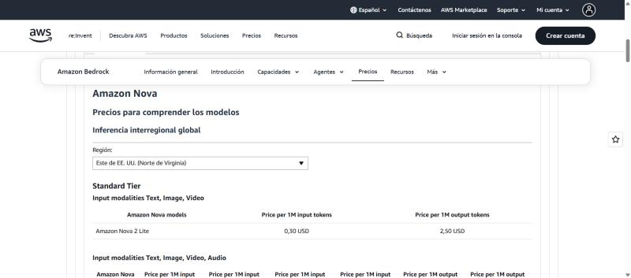 |
| 8 | Azure · Virtual Machines | Precio por hora en México | 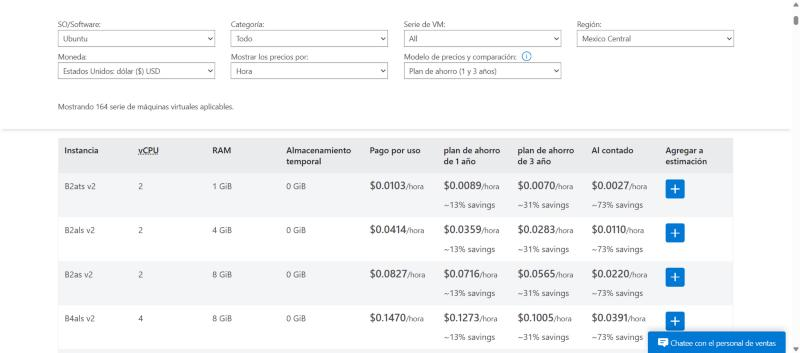 |
| 9 | Azure · App Service | Precio por hora en México | 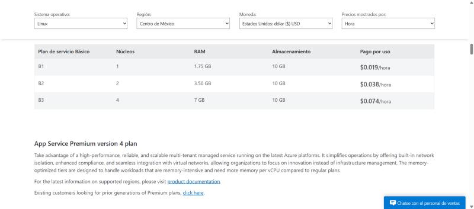 |
| 10 | Azure · Functions | Precio por GB/s y por millón de ejecuciones | 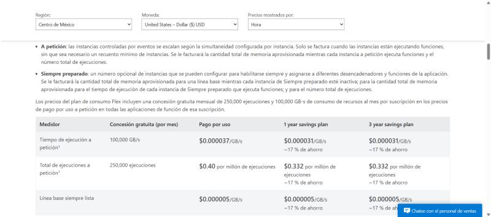 |
| 11 | Azure · AKS | Precio por clúster por hora | 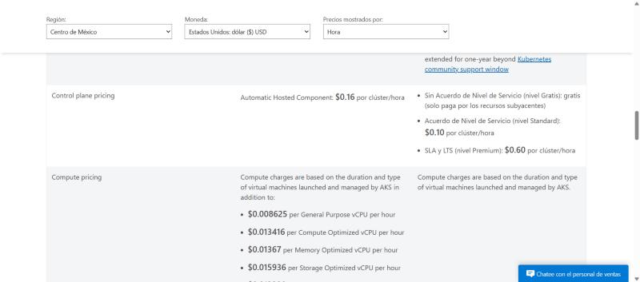 |
| 12 | Azure · Database for MySQL | Precio por hora en México | 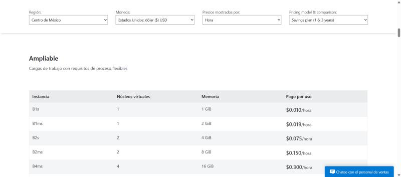 |
| 13 | Azure · Blob Storage | Precio por GB al mes en México | 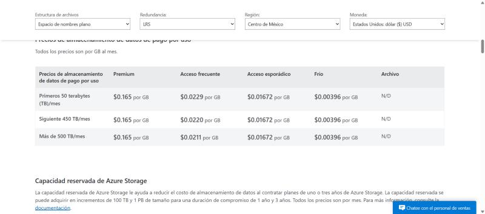 |
| 14 | Azure · OpenAI | Precio por millón de tokens; no todos los modelos están en México | 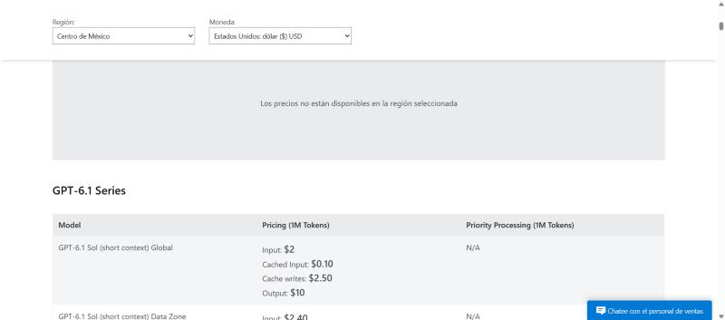 |
| 15 | SaaS · GitHub | Precio por usuario al mes | 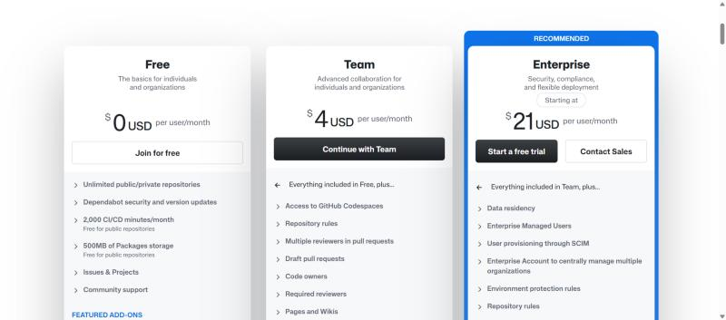 |

---

## 5. 5 características del NIST (B2)

| Característica (NIST SP 800-145) | Qué se observa en la consola | Evidencia |
|---|---|---|
| **Autoservicio bajo demanda** | Desde la consola uno mismo puede crear una máquina virtual sin pedírselo a nadie. No se terminó de crear. |  |
| **Amplio acceso a la red** | La misma cuenta de AWS se consulta desde otra herramienta, la terminal CloudShell, sin instalar nada. | 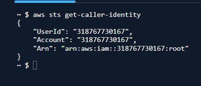 |
| **Agrupación de recursos** | Hay muchas regiones, entre ellas México, que comparten miles de clientes. |  |
| **Elasticidad rápida** | Hay más de mil tamaños de máquina, desde muy pequeñas hasta muy grandes, y se puede cambiar de tamaño en minutos. | 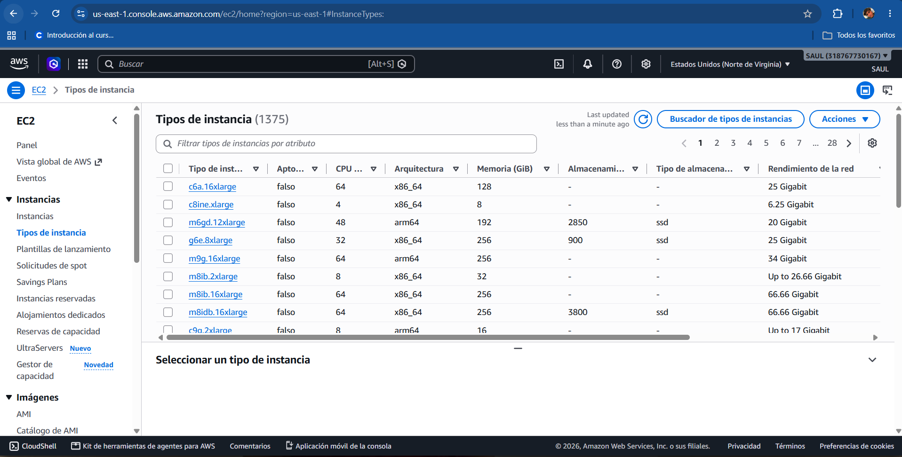 |
| **Servicio medido** | La consola mide lo que se gasta y lo compara con el presupuesto: 0.00 de 5.00 USD. |  |

---

## 6. Preguntas de análisis
**1. ¿Cuenta compartida del equipo o una por integrante?**
Conviene que cada integrante tenga su propia cuenta. Así cada quien tiene sus propios créditos (por ejemplo, 100 USD en AWS y 100 USD en Azure por persona) y nadie tiene que compartir contraseñas, algo que la práctica prohíbe. Con una cuenta compartida los créditos de una sola persona se acaban más rápido y no se sabe quién creó qué. La desventaja de tener cuentas separadas es que el gasto queda repartido, pero eso se controla con el presupuesto de 5 USD que cada uno puso en sus cuentas.

**2. ¿Cuánto más cara resultó la región de México?**
Con la misma arquitectura, México salió 4.8 % más caro en AWS (95.53 contra 91.12 USD al mes) y 8.5 % más caro en Azure (77.07 contra 71.05 USD al mes). La mayor diferencia en AWS está en la base de datos (+6.2 %) y en Azure en la máquina virtual (+10.1 %). La salida a internet cuesta lo mismo en las dos regiones. Aun así elegiríamos México si los usuarios están aquí, porque la respuesta es más rápida, o si se manejan datos personales que conviene guardar dentro del país. Para un proyecto escolar sin datos sensibles, Estados Unidos sigue siendo más barato y tiene más servicios; por ejemplo, Elastic Beanstalk no existe en la región de México.

**3. ¿Qué seguiría cobrando aunque apagáramos la VM?**
Al apagar la máquina virtual solo deja de cobrarse el tiempo de cómputo. Siguen cobrando:
- El disco de la VM, por GB al mes (unos 2.52 USD en AWS y 2.64 USD en Azure).
- La IP pública, por hora (unos 3.65 USD al mes en AWS).
- El balanceador de carga, por hora aunque nadie lo use (23.38 USD al mes).
- La base de datos, por hora y por GB (27.24 USD en AWS y 16.18 USD en Azure).
- El almacenamiento de objetos, por GB al mes.

En AWS, apagar la VM solo quita unos 32 de los 95.53 USD al mes.

**4. ¿Qué modelo de cómputo conviene para el proyecto?**
Para una aplicación web pequeña conviene PaaS, por ejemplo App Service de Azure. Se cobra por hora del plan, tiene un nivel gratuito (F1) y el proveedor se encarga del sistema operativo y las actualizaciones. Una VM (IaaS) cobra las 730 horas del mes aunque nadie la use, y los contenedores gestionados (AKS o EKS) son demasiado para un proyecto de este tamaño. Para tareas sueltas en segundo plano sirve serverless (Functions o Lambda), que cobra por ejecución y tiene 1 millón de ejecuciones gratis al mes.

**5. ¿Cómo detener el gasto automáticamente?**
Las alertas solo mandan un correo; no detienen nada. En AWS se pueden agregar **acciones de presupuesto**: cuando el gasto llega a un umbral (por ejemplo, el 100 % de los 5 USD), AWS puede detener instancias EC2 o RDS, o bloquear la creación de recursos nuevos. Se configura en Billing and Cost Management → Budgets → el presupuesto → Actions → Add action, eligiendo el umbral y el tipo de acción. En Azure se puede hacer algo parecido con un grupo de acciones ligado al presupuesto. Además, la suscripción Azure for Students se desactiva sola cuando se acaba el crédito.

**6. ¿Qué nos dice el recorte de las capas gratuitas?**
Que las capas gratuitas pueden cambiar en cualquier momento: Oracle redujo la suya a la mitad en junio de 2026 y AWS cambió en 2025 a un plan que se cierra a los 6 meses. Por eso no conviene depender de un solo proveedor. Como equipo, lo que haríamos es tener cuentas en al menos dos nubes, anotar cuándo vencen los créditos de cada quien, mantener los presupuestos con alertas, borrar los recursos al terminar cada práctica para que los créditos duren y tener un plan B para correr el proyecto en una computadora local si nos quedamos sin nube.

---

**Evidencias B3 — Carlos Hernández (Azure)**

| Captura | |
|---|---|
| Sin recursos creados |  |
| Gasto del mes y créditos |  |
| Presupuesto activo |  |

## 7. Lista de verificación de seguridad y costos (B3)

| Verificación | Jorge (AWS/Azure) | Saúl (AWS/Azure) | Carlos (Azure/GCP) |
|---|---|---|---|
| Presupuesto de 5 USD con alertas por correo en cada cuenta | ☑ | ☑ | ☑ |
| Presupuesto de gasto cero (AWS) | ☑ | ☑ | — |
| Gasto del mes en 0.00 | ☑ | ☑ | ☑ |
| Ningún recurso creado | ☑ | ☑ | ☑ |
| Ninguna captura muestra contraseñas, llaves ni datos de tarjeta | ☑ | ☑ | ☑ |
| No hay archivos de credenciales en el repositorio | ☑ | ☑ | ☑ |

---

## 8. Conclusiones

**Jorge Alberto Paniagua Escamilla:** Con las calculadoras vi que la misma arquitectura sale más barata en Azure que en AWS, y que la región de México cuesta un poco más que la de Estados Unidos. Aun así, puede convenir usar México si los usuarios están aquí.

**Saúl Andrés Bernal Jardón:** Aprendí que poner un presupuesto con alertas es lo primero que hay que hacer al abrir una cuenta en la nube. Es fácil, toma pocos minutos y así te enteras si algo empieza a cobrar sin que te des cuenta.

**Carlos Antonio Hernández Villeda:** Me di cuenta de que apagar una máquina virtual no significa dejar de pagar. El disco, la base de datos y el balanceador siguen cobrando, así que hay que borrar los recursos cuando ya no se usan.

---

## 9. Referencias

- AWS. (2025, 15 de julio). *AWS Free Tier now offers $200 in credits and 6-month free plan.* https://aws.amazon.com/about-aws/whats-new/2025/07/aws-free-tier-credits-month-free-plan/
- AWS. (2026). *Using a budget template (simplified).* https://docs.aws.amazon.com/cost-management/latest/userguide/budget-templates.html
- AWS. (2026). *Configuring a budget action.* https://docs.aws.amazon.com/cost-management/latest/userguide/budgets-controls.html
- AWS. (2024). *New – AWS Public IPv4 Address Charge.* https://aws.amazon.com/blogs/aws/new-aws-public-ipv4-address-charge-public-ip-insights/
- AWS. (2026). *AWS Pricing Calculator* y *AWS Price List* (EC2, RDS, S3, ELB, Data Transfer; consultados el 14/10/2026). https://calculator.aws/
- AWS. (2026). *AWS Regional Services List.* https://aws.amazon.com/about-aws/global-infrastructure/regional-product-services/
- Microsoft. (2026). *Azure for Students.* https://azure.microsoft.com/free/students/
- Microsoft Learn. (2026). *Tutorial: Create and manage budgets.* https://learn.microsoft.com/azure/cost-management-billing/costs/tutorial-acm-create-budgets
- Microsoft. (2026). *Azure Pricing Calculator* y *Azure Retail Prices API* (consultados el 14/10/2026). https://azure.microsoft.com/pricing/calculator/
- Microsoft. (2026). *Azure Database for MySQL – Flexible Server pricing.* https://azure.microsoft.com/pricing/details/mysql/flexible-server/
- Mell, P. y Grance, T. (2011). *The NIST Definition of Cloud Computing* (SP 800-145). NIST. https://doi.org/10.6028/NIST.SP.800-145
- Wiggers, S. (2026, 3 de julio). *Oracle Quietly Halves Free Tier Ampere A1 Compute Limits with No Public Announcement.* InfoQ. https://www.infoq.com/news/2026/07/oracle-cloud-free-tier-limits/
- FinOps Foundation. (2026). *FinOps Framework.* https://www.finops.org/framework/

---

## 10. Uso de IA

| Herramienta | Para qué se usó |
|---|---|
| Claude (Anthropic) | Hacer las operaciones de las tablas 2a y 2b |

---

## 11. Tabla de contribución

| Integrante | Contribución |
|---|---|
| Jorge Alberto Paniagua Escamilla | Cuentas y presupuestos de AWS y Azure (A1, A2), estimaciones de AWS y Azure (A3), tabla de modelos de servicio |
| Saúl Andrés Bernal Jardón | Cuentas de AWS y Azure (A1), presupuestos (A2), exportación de las 4 estimaciones (A3) |
| Carlos Antonio Hernández Villeda | Cuentas de Azure y Google Cloud (A1), presupuestos (A2), revisión de recursos y gasto en cero (B3) |